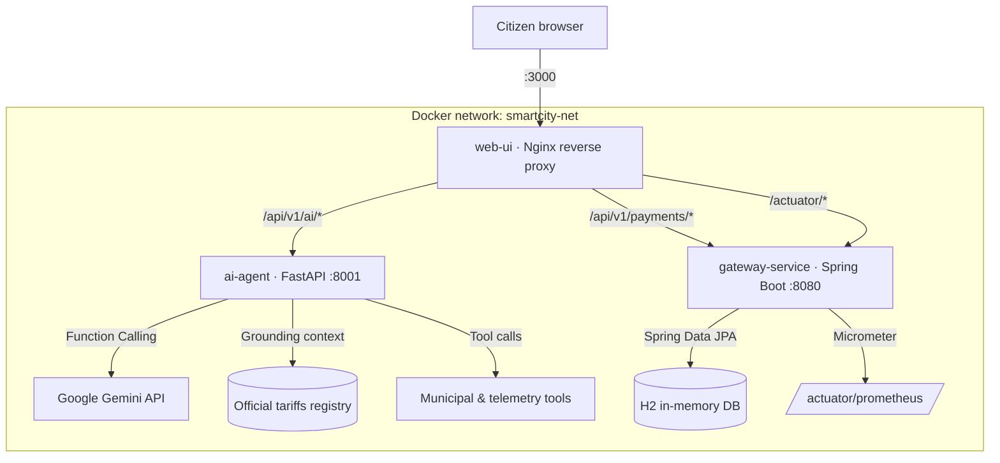

# Istanbul SmartCity AI Operating System

> A cloud-native platform that combines a grounded LLM orchestrator with a transactional financial gateway for municipal services in Istanbul.

[](https://openjdk.org/projects/jdk/17/)
[](https://spring.io/projects/spring-boot)
[](https://www.python.org/)
[](https://fastapi.tiangolo.com)
[](https://ai.google.dev/)
[](https://nginx.org/)
[](https://www.h2database.com/)
[](https://docs.docker.com/compose/)

---

## Table of contents

1. [Overview](#overview)
2. [Architecture](#architecture)
3. [Technology stack](#technology-stack)
4. [Getting started](#getting-started)
5. [Endpoints and ports](#endpoints-and-ports)
6. [Fault tolerance](#fault-tolerance)
7. [Benchmarks](#benchmarks)
8. [Local development](#local-development)
9. [Repository layout](#repository-layout)
10. [License](#license)

---

## Overview

The Istanbul SmartCity AI Operating System lets citizens and visitors ask questions in natural language (Russian or Turkish) about transport, utility bills, parking, residence permits and housing, and pay for municipal services in the same interface.

The design keeps two concerns apart:

- **Language understanding.** The AI agent picks the right municipal tool through Gemini Function Calling. Every prompt is grounded in the official tariff regulation (`ai-service/data/istanbul_tariffs.txt`), which keeps prices and policy answers deterministic.
- **Money movement.** Payments never go through the LLM. They are executed by a dedicated Spring Boot gateway that stores each transaction through JPA and exposes Prometheus metrics.

## Architecture



| Service | Container | Responsibility |
|---|---|---|
| `web-ui` | `smartcity-frontend` | Serves the single-page app and reverse-proxies API calls, so the browser only talks to one origin and needs no CORS. |
| `ai-agent` | `smartcity-ai-core` | Turns natural language into tool calls, grounds answers with RAG, and returns structured action cards (`ROUTE_CARD`, `PAYMENT_CARD`, `INFO_GUIDE`, `ESTATE_CARD`). |
| `gateway-service` | `smartcity-gateway` | Processes and stores payments and exposes health and Prometheus telemetry. |

Startup order is enforced with health checks: `ai-agent` waits until `gateway-service` is healthy, and `web-ui` waits until both are healthy.

## Technology stack

| Layer | Technology |
|---|---|
| Financial gateway | Java 17, Spring Boot 3.2.3, Spring Data JPA, Spring Security, H2, Actuator, Micrometer Prometheus |
| AI orchestrator | Python 3.11, FastAPI, Pydantic v2, `google-generativeai`, httpx |
| Frontend | Vanilla ES modules, Tailwind CSS (CDN), Lucide icons, Nginx Alpine |
| Infrastructure | Docker multi-stage builds, Docker Compose v2 |

## Getting started

### Prerequisites

- Docker Engine with Compose v2 (`docker compose version`)
- Outbound HTTPS access. The AI agent calls the Gemini API, and the UI loads Tailwind and Lucide from public CDNs.
- A Google Gemini API key from [Google AI Studio](https://aistudio.google.com/app/apikey)

### 1. Configure the environment

```bash
cp .env.example .env
```

Open `.env` and set your key:

```env
GEMINI_API_KEY=your_gemini_api_key_here
```

| Variable | Default | Description |
|---|---|---|
| `GEMINI_API_KEY` | — | Google Gemini API key (required for AI answers) |
| `GEMINI_MODEL` | `gemini-3.5-flash-lite` | Gemini model name |
| `GEMINI_TIMEOUT_SECONDS` | `15` | Hard limit for one Gemini call, including short retries on 503 |
| `JWT_SECRET` | — | Token signing secret for the gateway. Generate one with `openssl rand -hex 32`. |
| `SPRING_PROFILES_ACTIVE` | `default` | Spring profile of the gateway (`.env.example` sets `prod`) |
| `JWT_EXPIRATION_MS` | `86400000` | Token lifetime in milliseconds |
| `FRONTEND_PORT` / `SPRING_BACKEND_PORT` / `AI_SERVICE_PORT` | `3000` / `8080` / `8001` | Host port mappings |

### 2. Build and start the stack

```bash
docker compose up --build -d
```

### 3. Verify

```bash
docker compose ps                                   # all three services should report (healthy)
curl http://localhost:8080/actuator/health          # {"status":"UP",...}
curl http://localhost:8001/                         # {"status":"UP",...}
curl -X POST http://localhost:3000/api/v1/ai/orchestrate \
     -H "Content-Type: application/json" \
     -d '{"message":"İSKİ su faturamı göster","language":"tr"}'
```

Then open **http://localhost:3000**.

To stop the stack:

```bash
docker compose down
```

## Endpoints and ports

| Component | Host port | Method | Path | Purpose |
|---|---|---|---|---|
| Web UI | **3000** | `GET` | `/` | Citizen single-page app |
| Web UI (proxy) | 3000 | `POST` | `/api/v1/ai/orchestrate` | Proxied to `ai-agent` |
| Web UI (proxy) | 3000 | `POST` | `/api/v1/payments/process` | Proxied to `gateway-service` |
| Web UI (proxy) | 3000 | `GET` | `/actuator/health` | Proxied to `gateway-service` |
| Gateway | **8080** | `POST` | `/api/v1/payments/process` | Process and store a payment |
| Gateway | 8080 | `GET` | `/actuator/health` | Liveness and readiness |
| Gateway | 8080 | `GET` | `/actuator/prometheus` | Prometheus scrape target |
| AI agent | **8001** | `GET` | `/` | Service health |
| AI agent | 8001 | `POST` | `/api/v1/ai/orchestrate` | Natural-language orchestration |

### Request and response contracts

**Payment:** `POST /api/v1/payments/process`

```json
// request
{ "userId": 1, "serviceId": 2, "amount": 150.00 }
// response 200
{ "transactionId": 1, "status": "SUCCESS", "amountProcessed": 150.0, "serviceId": 2,
  "createdAt": "2026-10-05T12:00:00", "message": "Smart City payment completed and persisted successfully." }
```

**AI orchestration:** `POST /api/v1/ai/orchestrate`

```json
// request (history is optional: previous turns, oldest first; roles "user" / "assistant")
{ "message": "Öğrenci için ne kadar?", "language": "tr",
  "history": [ { "role": "user", "content": "Metrobüs ücreti ne kadar?" },
               { "role": "assistant", "content": "Tek geçiş ücreti 17.70 TRY." } ] }
// response 200 (CitizenResponse)
{ "message": "...", "intent": "SEARCH_TRANSPORT_ROUTE", "grounded_source": "İBB TUHİM Toplu Ulaşım Ağı (2026)",
  "action": { "type": "ROUTE_CARD", "data": { "origin": "...", "destination": "...", "fare": "17.70 TRY", "duration": "...", "steps": ["..."] } },
  "suggested_replies": [] }
```

## Fault tolerance

The AI agent always answers with HTTP 200 and a valid `CitizenResponse`, so the UI never hangs on a 5xx error.

| Failure | Behaviour |
|---|---|
| Missing or invalid API key (401/403), quota exceeded (429), timeout, network error | Returns `intent: "FALLBACK"` with a neutral, localized message and `action: null`. |
| Unknown tool or tool execution error | Returns `intent: "FALLBACK"`. |

Payments do not depend on the AI agent and keep working when Gemini is unavailable.

Each request makes **one** Gemini call. When the model selects a tool, the agent returns the tool's action card with a fixed, localized confirmation sentence instead of making a second synthesis call. This halves latency and free-tier quota usage. Follow-up questions are answered from the conversation history (the last 12 turns) without calling the same tool again.

## Benchmarks

The benchmark scripts run on the host against the running stack. Install the dependencies in a virtual environment:

```bash
python -m venv .venv
source .venv/bin/activate          # Windows: .venv\Scripts\activate
pip install httpx matplotlib numpy
```

| Script | Target (base URL env var, default) | Output |
|---|---|---|
| `python benchmark_backend.py` | `BENCHMARK_BACKEND_URL`, `http://localhost:8080` | `benchmark_backend.json`: throughput, avg / p95 / p99 latency, and error rate at 50 / 200 / 500 concurrent users |
| `python benchmark_rag.py` | `BENCHMARK_AI_URL`, `http://localhost:8001` | `benchmark_rag.json`: faithfulness, hallucination rate, and source grounding score over 8 tariff questions |
| `python generate_plots.py` | reads both JSON files | `fig_backend_performance.{png,pdf}`, `fig_rag_evaluation.{png,pdf}` |

The scripts add the API paths (`/api/v1/payments/process`, `/api/v1/ai/orchestrate`) to the base URL. To benchmark through the Nginx proxy instead:

```bash
export BENCHMARK_BACKEND_URL=http://localhost:3000     # PowerShell: $env:BENCHMARK_BACKEND_URL="http://localhost:3000"
export BENCHMARK_AI_URL=http://localhost:3000
python benchmark_backend.py && python benchmark_rag.py && python generate_plots.py
```

If a JSON file is missing or incomplete, `generate_plots.py` falls back to the reference series and adds `(reference)` to the chart title.

## Local development

| Service | Command | Port |
|---|---|---|
| Gateway | `./mvnw spring-boot:run` | 8080 |
| AI agent | `cd ai-service && pip install -r requirements.txt && uvicorn main:app --reload --port 8001` | 8001 |
| Frontend | Served by the `web-ui` container. It relies on the Nginx proxy for API calls. | 3000 |

When you run the AI agent outside Docker, set `SPRING_BACKEND_URL=http://localhost:8080` and `GEMINI_API_KEY` in `ai-service/.env`.

## Repository layout

```
.
├── Dockerfile                 # Multi-stage build for gateway-service (Maven → JRE 17 Alpine)
├── docker-compose.yml         # Three-service stack with health-gated startup
├── pom.xml / src/             # Spring Boot financial gateway
├── ai-service/                # FastAPI orchestrator (agent/, providers/, tools/, data/)
├── frontend/                  # SPA + nginx.conf reverse proxy
├── benchmark_backend.py       # Gateway load test → benchmark_backend.json
├── benchmark_rag.py           # RAG faithfulness evaluation → benchmark_rag.json
├── generate_plots.py          # Publication-ready figures from benchmark JSON
└── docs/                      # IEEE report, UML diagrams, verification reports
```

## License

The source code is released under the [MIT License](LICENSE).

Third-party assets keep their own terms:

| Asset | Source | License |
|---|---|---|
| `frontend/assets/istanbul-bosphorus.mp4`, `istanbul-bosphorus.jpg` | Pexels video [#28800680](https://www.pexels.com/video/28800680/) | [Pexels License](https://www.pexels.com/license/) |
| Map tiles (loaded at runtime, not stored in the repository) | [OpenStreetMap](https://www.openstreetmap.org/copyright) | © OpenStreetMap contributors, ODbL |
| Leaflet, Tailwind CSS, Lucide (loaded from CDNs) | upstream projects | BSD-2-Clause, MIT, ISC |
